FULL STACK &nbsp; / &nbsp; AUTOMATIZACIÓN &nbsp; / &nbsp; IA

# Juan David Jaller

### De una necesidad real a una solución digital.

Desarrollo aplicaciones, automatizo procesos e integro chatbots y asistentes con IA.

[Proyecto destacado](#proyecto-destacado) &nbsp; · &nbsp; [Más proyectos](#mas-proyectos) &nbsp; · &nbsp; [Tecnologías](#tecnologias) &nbsp; · &nbsp; [Actividad](#actividad)

---

  

### Sobre mí

Soy ingeniero de sistemas y desarrollador Full Stack. Creo aplicaciones web, APIs y herramientas que conectan información, simplifican tareas y ayudan a resolver necesidades reales.

Mi trabajo abarca interfaces, servicios backend, bases de datos y automatización de procesos. También desarrollo prototipos de chatbots y asistentes con IA, integro modelos de lenguaje con herramientas y exploro flujos de colaboración entre agentes.

### Enfoque profesional

Me interesan oportunidades en **desarrollo Full Stack, backend, automatización y creación de chatbots y asistentes con IA**. Busco contribuir a soluciones que conecten aplicaciones, servicios y datos para reducir tareas manuales y mejorar la experiencia de las personas.

Combino el desarrollo de APIs e interfaces con la integración de servicios externos, herramientas CLI y flujos asistidos por IA. Me interesa seguir creciendo en un equipo que valore el código mantenible, las pruebas y la utilidad de lo que construye.

### Qué puedes revisar de mi trabajo

Mis repositorios reúnen proyectos de gestión, servicios backend, herramientas para desarrolladores e integración de IA y dispositivos.

- [**NexaKit**](https://github.com/Jcabr3ra1/nexakit): herramientas CLI, selección de skills y preparación de proyectos para trabajar con asistentes de IA.
- [**AVISENS**](https://github.com/Jcabr3ra1/Avisens-Project): aplicación web, API, prototipo de asistente conversacional e integración IoT.
- [**BsltProject**](https://github.com/Jcabr3ra1/BsltProject): servicios para operaciones bancarias, autenticación e integración de datos.
- [**Más repositorios**](https://github.com/Jcabr3ra1?tab=repositories): aplicaciones de gestión, APIs y proyectos web.

## 01 / Proyecto destacado

<table>
<tr><td>

AGROTECH · APLICACIÓN WEB + IoT · EN DESARROLLO

### 🌱 AVISENS

**La operación de una granja, conectada en un solo lugar.**

Una plataforma para organizar granjas, galpones y lotes; registrar la operación diaria y consultar indicadores productivos y lecturas ambientales.

**Organizar** → Granjas, galpones y lotes.  
**Registrar** → Alimentación, mortalidad y eventos sanitarios.  
**Consultar** → Indicadores productivos y condiciones ambientales.  
**Conectar** → Aplicación web, servicios backend y dispositivos ESP32.

[**Explorar AVISENS →**](https://github.com/Jcabr3ra1/Avisens-Project)

<strong>Ver más sobre el proyecto</strong>

AVISENS reúne la gestión de información de una granja con la integración de dispositivos del mundo físico. El proyecto combina frontend, backend y firmware para ESP32.

Me permite trabajar en la organización de módulos, el diseño de APIs, la presentación de información y la integración entre distintas partes de una aplicación.

**Flujo de trabajo:** ramas por funcionalidad, pull requests, revisión de cambios y comprobaciones de calidad con GitHub Actions.

</td></tr>
</table>

<strong>Revisar documentación, arquitectura e instalación</strong>

El README del proyecto explica el problema, los usuarios del sistema, la estructura del repositorio, el stack y los pasos para ejecutar sus componentes.

- [**Leer la documentación de AVISENS**](https://github.com/Jcabr3ra1/Avisens-Project#readme).
- [**Consultar el modelo de datos**](https://github.com/Jcabr3ra1/Avisens-Project/blob/main/MER.md).
- [**Conocer el flujo de colaboración**](https://github.com/Jcabr3ra1/Avisens-Project/blob/main/FLUJO-DE-TRABAJO.md).
- [**Revisar las comprobaciones automáticas**](https://github.com/Jcabr3ra1/Avisens-Project/actions).

**Estado:** proyecto de formación SENA en desarrollo activo. La aplicación web y la bitácora están implementadas; la app Android, las predicciones y la validación física del firmware tienen distintos niveles de avance. El README detalla esas diferencias y las validaciones pendientes.

## 02 / Explora mis proyectos

Abre cada proyecto para conocer qué resuelve y cómo está construido.

<strong>🧰 NexaKit</strong> — Contexto compartido para asistentes de IA

### El contexto de un proyecto, disponible entre sesiones y asistentes

Caja de herramientas para organizar memorias de proyecto en archivos de texto y preparar conexiones locales con **Codex, Claude Code y Gemini CLI**.

Incluye una CLI para crear y diagnosticar memorias, revisar cambios integrados en GitHub, preparar encargos y aplicar notas previamente revisadas con autorización y verificaciones.

**Qué muestra de mi trabajo:** herramientas para desarrolladores, organización del contexto, flujos de revisión y pruebas automatizadas.

**Tecnologías y enfoque:** JavaScript · Node.js · CLI · GitHub · Skills · integración con notas de Obsidian.

**Estado:** versión 0.1.0 en desarrollo, con verificación funcional local documentada. Las conexiones con clientes reales requieren comprobación; el lanzamiento automático de agentes sigue pendiente.

[Explorar NexaKit →](https://github.com/Jcabr3ra1/nexakit)

<strong>🌿 La Cañada Reverdece</strong> — Naturaleza y comunidad en la web

### Una ventana digital a un proyecto comunitario

Sitio web para presentar un vivero comunitario y recorridos por el bosque en Huila.

**Tecnología:** Astro.

[Visitar el sitio ↗](https://huilareverdece.com/) · [Explorar el código →](https://github.com/Jcabr3ra1/la-canada-reverdece)

<strong>🏦 BsltProject</strong> — Cuentas, transacciones y servicios

### Aplicación de sistema bancario

Proyecto con gestión de cuentas, transacciones y autenticación mediante servicios separados.

**Tecnologías:** Angular · Spring Boot · FastAPI · MongoDB.

[Explorar el código →](https://github.com/Jcabr3ra1/BsltProject)

<strong>📋 Gestión de trabajos</strong> — Entregas y fechas bajo control

### Organización de entregas académicas

Aplicación para organizar trabajos, consultar sus estados y hacer seguimiento a las fechas de cierre.

**Tecnologías:** React · TypeScript · Firebase.

[Explorar el código →](https://github.com/Jcabr3ra1/gestion-trabajos)

<strong>🏍️ Punto Motos</strong> — Gestión de repuestos y servicios de taller

### La operación de una tienda y taller de motocicletas

Proyecto para gestionar inventario, compras, ventas, caja y servicios de taller, con liquidación diaria de mecánicos y cierre de mes.

**Arquitectura propuesta:** aplicación de escritorio para Windows con React, TypeScript y Tauri 2; backend con Django y Django REST Framework, y base de datos local SQLite.

**Estado:** documentación funcional y técnica inicial; aplicación pendiente de implementación.

[Explorar el código →](https://github.com/Jcabr3ra1/Punto_Motos)

## 03 / Mi caja de herramientas

Tecnologías y herramientas presentes en mis proyectos, junto con el stack propuesto para Punto Motos.

**Interfaces web**

**Backend y APIs**

APIs REST, autenticación e integración de servicios. Django REST Framework forma parte de la arquitectura propuesta para Punto Motos.

**Automatización y asistentes con IA**

Herramientas CLI con Node.js, preparación de skills y memoria de proyectos en Obsidian, integración mediante **MCP** y flujos de revisión entre **Claude Code, Codex y Antigravity**. Prototipos de chatbots y asistentes con modelos de lenguaje.

<strong>Ver herramientas de datos, escritorio, desarrollo e integración</strong>

**Datos**

SQLite está contemplado para el almacenamiento local de Punto Motos.

**Aplicaciones de escritorio**

Tauri 2 con React y TypeScript en la arquitectura propuesta para Punto Motos en Windows.

**Desarrollo y entrega**

Control de versiones, pull requests, pruebas automatizadas y comprobaciones de calidad.

**Integración IoT**

Dispositivos **ESP32** para conectar software con lecturas del entorno en AVISENS.

## 04 / Cada contribución cuenta

Mi actividad pública en GitHub, convertida en una animación que se actualiza diariamente.

<picture>
  <source media="(prefers-color-scheme: dark)" srcset="https://raw.githubusercontent.com/Jcabr3ra1/Jcabr3ra1/refs/heads/output/github-snake-hunt-dark.svg" />
  <source media="(prefers-color-scheme: light)" srcset="https://raw.githubusercontent.com/Jcabr3ra1/Jcabr3ra1/refs/heads/output/github-snake-hunt.svg" />
  
</picture>

---

### ¿Conversamos sobre software?

Conoce más sobre mi trabajo y mi perfil profesional.

[**Conectemos en LinkedIn ↗**](https://www.linkedin.com/in/jdcabrera1/) &nbsp; · &nbsp; [**Ver todos mis proyectos →**](https://github.com/Jcabr3ra1?tab=repositories)

Juan David Jaller · Full Stack · Automatización · Chatbots e IA

